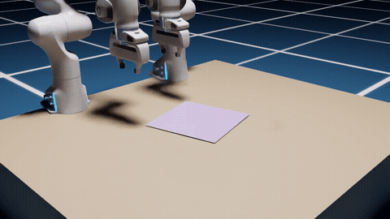
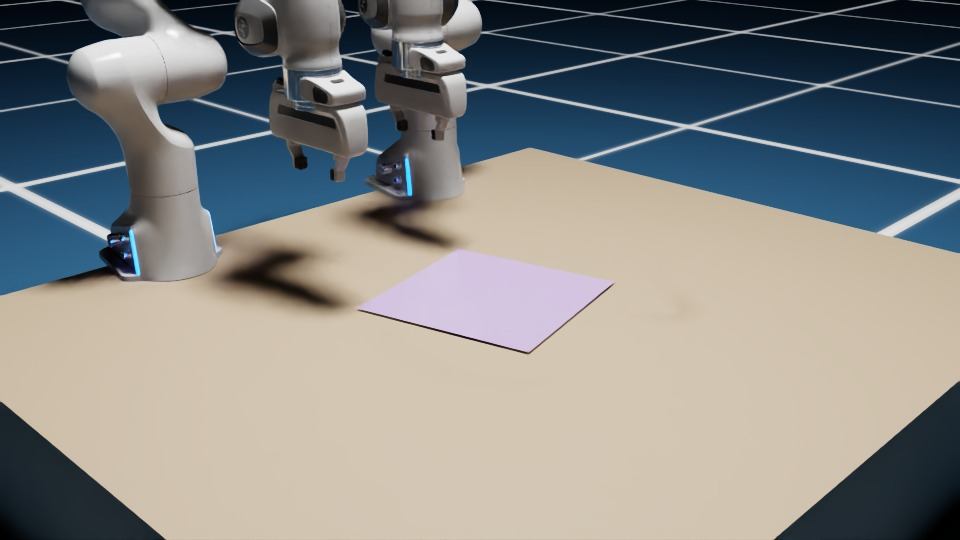
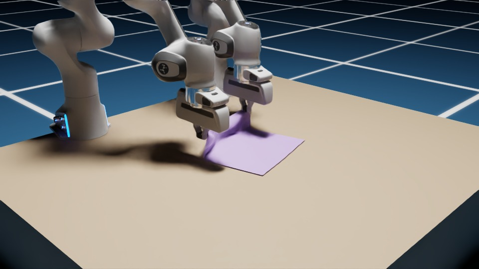
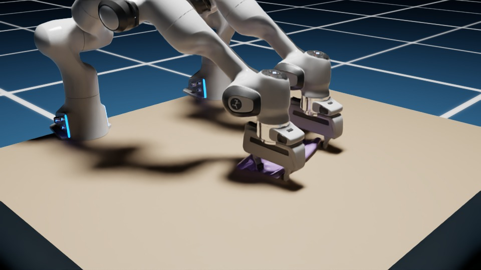
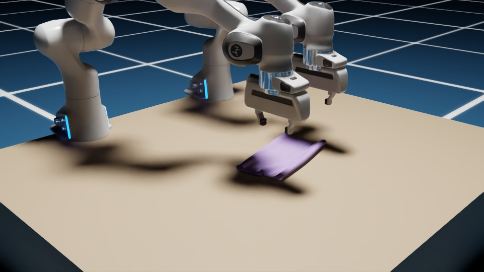

# 🧺 Bimanual Franka Cloth Folding — Isaac Sim + LeRobot ACT

**Two Franka Panda arms fold a 30 cm cloth in half — entirely in simulation.**

[](https://developer.nvidia.com/isaac-sim)
[](https://github.com/huggingface/lerobot)
[](https://arxiv.org/abs/2304.13705)
[](LICENSE)
[](https://github.com/dreamerarun/franka_cloth_fold/stargazers)
[](https://github.com/dreamerarun/franka_cloth_fold/releases/tag/v1.0-act)

<p align="center">
  
  <br>
  <em>Reference ACT checkpoint — closed-loop rollout in Isaac Sim (recorded with the eval camera below).</em>
</p>

This repo contains the **whole pipeline**: a scripted bimanual cloth-folding expert, a
[LeRobot](https://github.com/huggingface/lerobot) dataset converter, an ACT training recipe, and a
closed-loop evaluation harness that serves the policy over a local socket while Isaac Sim runs the
scene.

No real-robot code, no external assets to download for the Franka scene — Isaac Sim ships the
Franka Panda USD and the cloth is a PhysX PBD particle mesh generated in-script.

---

## 📸 Evaluation gallery

These frames come from an actual policy rollout (not a scripted replay). The cloth starts at a
random pose, both arms grasp the near edge, lift, carry it over, and release it on the far edge.

| Start | Grasp | Carry & fold | Done |
|---|---|---|---|
|  |  |  |  |
| random cloth pose | both grippers close | lift + roll over | folded (2.1 cm corner error) |

The wide **eval camera** (960×540, ~50° FOV) is created only when `WAM_RECORD_DIR` is set, so normal
data collection is unchanged. Details in [Recording your own eval](#-recording-your-own-eval).

---

## 📊 Results at a glance

| | |
|---|---|
| **Simulator** | Isaac Sim 5.1.0 (standalone), PhysX 5 |
| **Robot** | 2 × Franka Panda, parallel-jaw grippers, 7-DoF each |
| **Cloth** | 30 × 30 = 900-particle PBD cloth, 0.30 m square |
| **Physics / control** | 120 Hz physics, 15 Hz control (8 substeps) |
| **Observations** | overhead + front RGB 224×224, 16-D joint state |
| **Actions** | 16-D: 7 joints + 1 gripper per arm |
| **Demonstrations** | **200 episodes**, **32,542 frames**, 15 fps |
| **Policy** | LeRobot **ACT**, chunk size 30, 60k steps, batch 8 |
| **Eval (seed 900)** | **6 / 25 successful folds**, corner error < 4 cm, best **1.9 cm** |

> **Honest note on the numbers.** The scripted expert is filtered during collection — only
> successful folds are written to disk (200 saved). The ACT checkpoint is a single compact
> reference model and cloth manipulation is contact-sensitive: in our 25 rollout attempts it
> completed the fold 6 times. Successful folds land within 2–4 cm of the target edge. Train longer,
> collect more varied data, or evaluate with more tries to improve reliability.

---

## 🗂 Repository layout

| Path | What it does |
|---|---|
| `02_collect_franka.py` | Scripted expert **and** policy rollout; builds the scene, cloth, cameras |
| `franka_common.py` | Franka arm, table, cloth and task constants |
| `wam_common.py` | Shared physics/recording constants (legacy WAM names) |
| `03_convert_to_lerobot.py` | Raw episodes → LeRobot v3 dataset (parquet + videos) |
| `04_train.sh` | ACT / SmolVLA training commands |
| `policy_server.py` | Loads an ACT checkpoint, serves actions over `localhost:6000` |
| `run_rollout.sh` | Starts the server + runs closed-loop policy rollouts in Isaac Sim |
| `run_all.sh` | One-command pipeline: collect → convert → train |
| `legacy/02_collect_franka_old_method.py` | Snapshot before `--pin-substeps` / `--drag-fold` |
| `media/` | Evaluation screenshots and GIF used in this README |

Datasets (`dataset_*/`), `assets/`, `outputs/` and videos are git-ignored. The pipeline regenerates
all of them.

---

## 🚀 Quick start (evaluation)

### Prerequisites

- Ubuntu 22.04+ with an NVIDIA RTX GPU. The reference runs used a **6 GB** GPU — Isaac Sim and the
  policy server (CPU inference) fit together, but run **one Isaac Sim process at a time**.
- [Isaac Sim 5.1.0 standalone](https://developer.nvidia.com/isaac-sim) extracted somewhere, e.g.
  `~/Downloads/isaac-sim-standalone-5.1.0-linux-x86_64`.
- A conda env with LeRobot **0.5.1** and a CUDA-enabled PyTorch (tested: `torch 2.7.1+cu126`).
- The reference checkpoint at
  `outputs/train/wam_fold_act/checkpoints/last/pretrained_model`
  (download below, or train your own run).

### Reference checkpoint

The 183 MB ACT checkpoint used for the gallery is published as a GitHub release:

```bash
mkdir -p outputs/train/wam_fold_act/checkpoints/last
curl -L -o /tmp/act_wam_fold_act_pretrained_model.tar.gz \
  https://github.com/dreamerarun/franka_cloth_fold/releases/download/v1.0-act/act_wam_fold_act_pretrained_model.tar.gz
tar -xzf /tmp/act_wam_fold_act_pretrained_model.tar.gz \
  -C outputs/train/wam_fold_act/checkpoints/last
```

Alternatively, run the full pipeline in [Full pipeline from scratch](#-full-pipeline-from-scratch)
to produce the same directory.

### 0. Clone and set paths

```bash
git clone https://github.com/dreamerarun/franka_cloth_fold.git
cd franka_cloth_fold

export WAM="$PWD"
export ISAAC="$HOME/Downloads/isaac-sim-standalone-5.1.0-linux-x86_64"
export CONDA_ENV=lerobot
```

All scripts resolve the repo root from their own location. The only external path is `ISAAC`;
`run_all.sh` and `run_rollout.sh` accept `ISAAC=...`, `CONDA_ENV=...` and `CKPT=...` overrides.

### 1. Smoke-test the scripted expert

GUI (first run — you should see the table, two arms and the cloth):

```bash
cd "$ISAAC"
./python.sh "$WAM/02_collect_franka.py" --episodes 2 --out "$WAM/dataset_smoke"
```

Headless (what the pipeline uses):

```bash
cd "$ISAAC"
./python.sh "$WAM/02_collect_franka.py" --headless --episodes 2 --out "$WAM/dataset_smoke"
```

Each saved episode contains `meta.json`, `front/*.jpg` and `overhead/*.jpg`.

### 2. Run the trained policy

```bash
cd "$WAM"
bash run_rollout.sh 8 900 /tmp/rollout_eval.log
```

This launches `policy_server.py` (CPU), waits for the socket, then runs up to 8 closed-loop tries in
headless Isaac Sim. Look for the per-try result and the summary:

```text
[ep] try 8: ok=True  corner_err=0.021m ...
[done] saved 1 / 8 tries in 198s -> /tmp/rollout_out_900
```

`corner_err` is the mean distance between the folded near edge and the original far edge;
`ok=True` means it is below `--edge-tol` (4 cm).

> The reference checkpoint is contact-sensitive. Run 10–20 tries to see successful folds; failures
> are usually partial folds, not crashes.

---

## 🧪 Recording your own eval

Two environment variables make the eval produce README-ready media:

| Variable | Effect |
|---|---|
| `WAM_RECORD_DIR=/path` | Adds a 960×540 eval camera at a 3/4 view; saves every control step as `tryN_TTT.jpg` |
| `WAM_ROLLOUT_FRAMES=1` | Also dumps the policy's 224×224 observations for the first 3 tries |

```bash
cd "$WAM"
WAM_RECORD_DIR=/tmp/rollout_hi bash run_rollout.sh 8 900 /tmp/rollout_eval.log

# the successful try's frames, e.g. try 8
ls /tmp/rollout_hi/try8_*.jpg
```

Build a GIF from a successful try (the repo's `media/eval_fold.gif` was made this way):

```bash
ffmpeg -framerate 15 -start_number 0 -i /tmp/rollout_hi/try8_%03d.jpg \
  -vf "fps=10,scale=480:-1:flags=lanczos,split[s0][s1];[s0]palettegen=max_colors=128[p];[s1][p]paletteuse=dither=bayer" \
  -loop 0 media/eval_fold.gif
```

Keep `WAM_RECORD_DIR` unset for normal data collection — the extra camera costs render time and is
not part of the policy input.

---

## 🏗 Full pipeline from scratch

### 1. Environment

```bash
conda create -n lerobot python=3.12 -y
conda activate lerobot

# ACT is part of LeRobot core — no extra needed
pip install "lerobot==0.5.1"
pip install torch torchvision --index-url https://download.pytorch.org/whl/cu126
```

Verify the checkpoint API used by the server:

```bash
python - <<'PY'
from lerobot.policies.act.modeling_act import ACTPolicy
from lerobot.policies.factory import make_pre_post_processors
print("lerobot ACT API ok")
PY
```

> The pipeline was developed with `lerobot 0.5.1`. Flag names in `lerobot-train` change between
> releases; if a flag is rejected, check `lerobot-train --help`.

### 2. Collect demonstrations (200 episodes)

```bash
cd "$ISAAC"
./python.sh "$WAM/02_collect_franka.py" \
  --headless --episodes 200 --max-tries 1000 --seed 0 --out "$WAM/dataset_raw"
```

or let `run_all.sh` resume/skip work automatically:

```bash
bash run_all.sh collect     # EPISODES=200 by default
```

The scripted expert only saves **successful** folds (`--edge-tol 0.04`). Cloth pose is jittered
(±3 cm), so the 200 episodes cover slightly different initial conditions. On the reference machine
this produced 32,542 frames (≈163 frames/episode at 15 fps).

### 3. Convert to a LeRobot dataset

```bash
conda activate lerobot
cd "$WAM"
python 03_convert_to_lerobot.py \
  --raw dataset_raw --repo-id local/wam_fold --root "$HOME/lerobot_data/wam_fold"
```

Output (`~/lerobot_data/wam_fold`) is a LeRobot v3 dataset:

- `observation.images.overhead`, `observation.images.front` — 224×224 RGB
- `observation.state`, `action` — 16-D
- 15 fps, 200 episodes, 32,542 frames

### 4. Train ACT

```bash
conda activate lerobot
cd "$WAM"
bash 04_train.sh act
```

ACT config: chunk size 30, 30 action steps, batch 8, 60k steps, checkpoints every 10k.
Output: `outputs/train/wam_fold_act/checkpoints/last/pretrained_model`.

`04_train.sh smolvla` is also included (SmolVLA base + one empty camera), but the README results
and the `v1.0-act` release uses ACT.

### 5. Evaluate

```bash
cd "$WAM"
bash run_rollout.sh 8 900 /tmp/rollout_eval.log
```

or with recording:

```bash
WAM_RECORD_DIR=/tmp/rollout_hi bash run_rollout.sh 8 900 /tmp/rollout_eval.log
```

The policy runs on CPU by default so the GPU is free for Isaac Sim rendering. With a larger GPU you
can pass `--device cuda` to `policy_server.py` (edit `run_rollout.sh` or start the server manually).

---

## 🧠 The scripted expert: old vs new method

Both methods live in `02_collect_franka.py`; the flags change how the held edge is pinned and how
the fold is executed.

| Method | Command | Idea |
|---|---|---|
| **Default** (training data) | `./python.sh 02_collect_franka.py --headless --out dataset_raw` | single fold, lift/arc/place, 2 cm release height |
| **Old** | `... --line-pin --double-fold --place-z 0.012` | lift 10–14 cm, arc over, pins once per control step |
| **New** | `... --line-pin --double-fold --pin-substeps --drag-fold --place-z 0.012` | low ~4 cm lift, rolling descent, pins every physics substep |

The **reference ACT checkpoint was trained on the default single-fold data**, and the eval uses
defaults. If you collect with different flags, train on the matching distribution.

Other knobs:

| Flag | Default | Purpose |
|---|---|---|
| `--bend` | `50` | cloth bending stiffness |
| `--place-z` / `--place-z2` | `0.02` / `0.03` | release height for fold 1 / fold 2 |
| `--jit` | `0.004` | waypoint noise (domain randomization) |
| `--damp` | `0.05` | cloth damping |
| `--dwell` | `0.0` | pause with open grippers during descent |
| `--max-drift` | `0.06` | max allowed far-edge drift during the fold |
| `--edge-tol` | `0.04` | success threshold (mean corner error) |
| `--max-tries` | `6` | attempts per saved episode |

`legacy/02_collect_franka_old_method.py` is a frozen snapshot from before `--pin-substeps` and
`--drag-fold`.

---

## 🧰 How the evaluation works

1. `policy_server.py` loads the ACT checkpoint (weights + LeRobot pre/post-processors) and listens on
   `localhost:6000` with a `multiprocessing` auth key.
2. Isaac Sim builds the scene and, per control step (15 Hz), sends the two 224×224 RGB frames and
   the 16-D joint state to the server.
3. ACT predicts a 30-step action chunk; the server returns actions one at a time.
4. The sim applies the 16-D action through Lula IK + joint targets, steps 8 physics substeps, and
   checks whether the cloth is folded at the end.
5. On reset, the policy's action queue and processor state are cleared for the next episode.

The eval never writes episodes by default; only the final metrics are printed. Use
`WAM_RECORD_DIR` if you want the frames.

---

## 🩺 Troubleshooting

| Symptom | Fix |
|---|---|
| `server did not start` | Check `/tmp/policy_server.log`. The conda env must have LeRobot and the `CKPT` path must exist. |
| `Address already in use` on port 6000 | `PORT=6001 bash run_rollout.sh ...` (and matching `--policy-port` is handled by the script). |
| Isaac Sim crashes / `cudaErrorMemoryAllocation` | Only one GUI/Isaac process per GPU. Kill stale `isaac-sim`/`python.sh` processes and retry. |
| `no NVIDIA environment` | Isaac Sim assets root is unavailable; the scene falls back to a ground plane. Visual only. |
| Rollouts fail but the arms move | The policy is contact-sensitive. Try more seeds/tries, collect more data, or train longer. Check that eval flags match the training data. |
| Recorded frames are extremely zoomed | Isaac's default camera focal length is telephoto (`5.0` in this API); the eval camera sets `2.25` (~50° FOV). |
| `dataset_smoke`/`dataset_raw` already exists | The collector appends new episodes; delete the folder or use a new `--out` for a clean run. |

---

## 📝 Notes and limitations

- **Simulation only.** No real Franka is used; no hardware calibration or safety layer is included.
- The cloth is a PhysX PBD particle mesh (900 particles). It is not a thin-shell FEM model, but it
  is fast enough for closed-loop RGB policy training.
- The reference ACT checkpoint is a small single-GPU model, not a benchmark-beating policy. The repo
  is meant as a clean, reproducible starting point for bimanual deformable manipulation.
- `01_build_wam.py` and `wam_common.py` are remnants of an earlier Barrett WAM variant. The Franka
  pipeline (`02_collect_franka.py` + `franka_common.py`) does **not** need them; `run_all.sh` keeps
  the legacy build stage for compatibility and it can be skipped.

---

## 📚 Acknowledgements

- [NVIDIA Isaac Sim](https://developer.nvidia.com/isaac-sim) — simulation, PhysX cloth, Lula IK
- [Hugging Face LeRobot](https://github.com/huggingface/lerobot) — dataset format, ACT implementation
- [ACT: Learning Fine-Grained Bimanual Manipulation with Low-Cost Hardware](https://arxiv.org/abs/2304.13705)
  (Zhao et al., 2023)
- [Franka Robotics](https://franka.de/) — Panda model shipped with Isaac Sim

## 📄 License

MIT — see [LICENSE](LICENSE).
